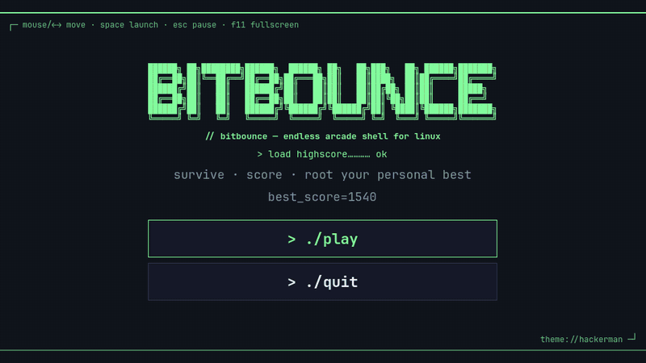
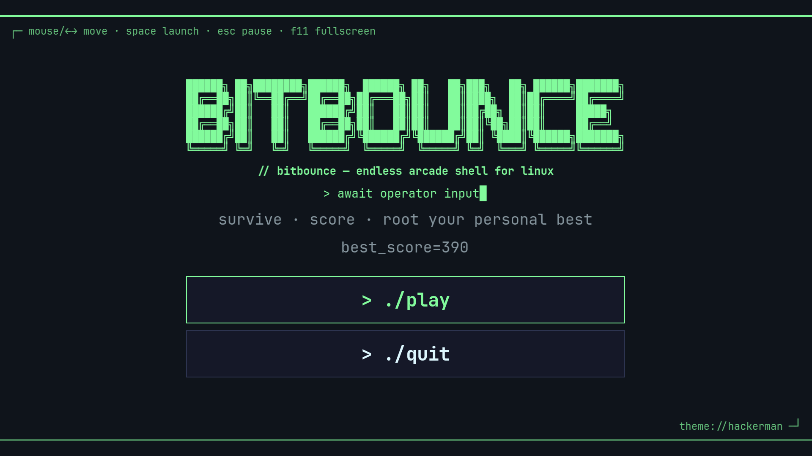
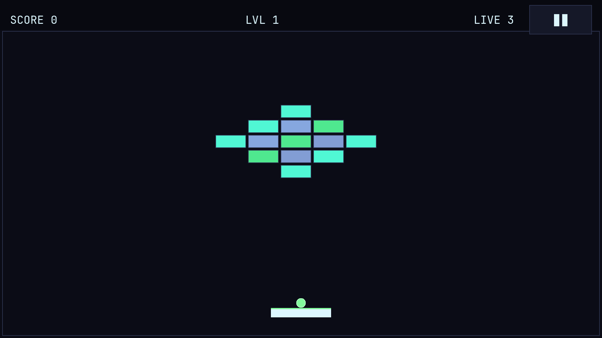
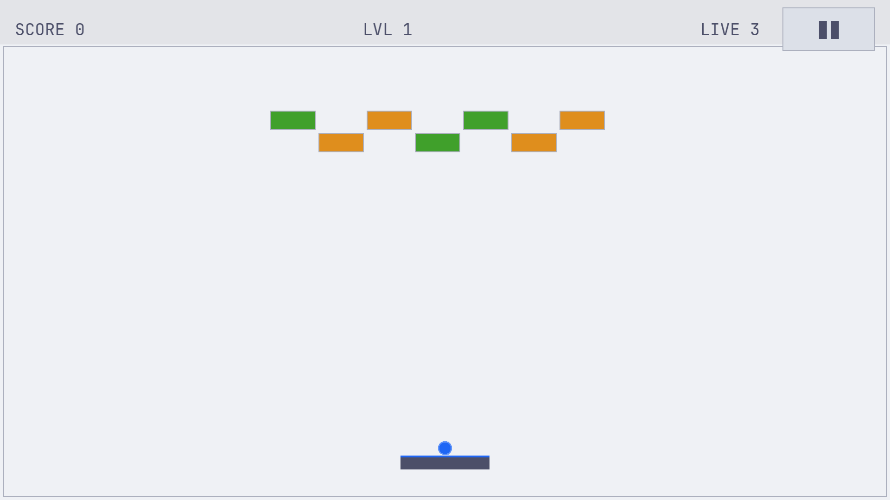
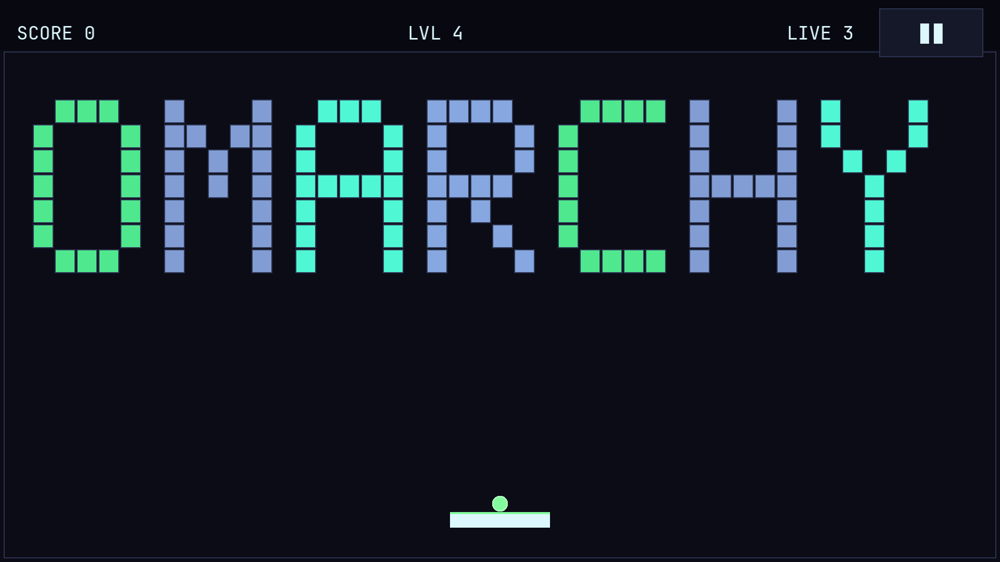

# Bitbounce

An endless brick-breaking arcade game for Linux, built with Godot 4.5.
It uses a terminal-style look and **picks up your [Omarchy](https://omarchy.org) theme live**: switch themes and the game recolors itself while you play.





| Omarchy theme: hackerman | Omarchy theme: catppuccin-latte |
|---|---|
|  |  |

- Endless, seeded levels that get faster and denser
- 3 lives, score, and a saved personal best
- Mouse or keyboard (including Vim keys), fullscreen with F11
- Runs natively on Wayland (Hyprland) and also on X11
- An OMARCHY level spelled out in bricks on level 4, then every 10 levels (14, 24, ...)
- Rare hidden levels to find from level 3 onward



## Install

### From a release (recommended)

```bash
curl -LO https://github.com/Ivangrx/bitbounce-linux/releases/latest/download/bitbounce-linux-x86_64.tar.gz
tar xzf bitbounce-linux-x86_64.tar.gz
cd bitbounce
./install.sh
```

Or download the tarball by hand from the [Releases](https://github.com/Ivangrx/bitbounce-linux/releases) page.

This installs to your user account with no root needed:

- the game into `~/.local/share/bitbounce/app/`
- the `bitbounce` command into `~/.local/bin/`
- a desktop entry, so it shows up in Omarchy's launcher (Super + Space → "Bitbounce")

To remove it, run `./uninstall.sh`. Add `--purge` to also delete your saved best score.

### From source

```bash
git clone https://github.com/Ivangrx/bitbounce-linux.git
cd bitbounce-linux
./packaging/build.sh        # downloads Godot 4.5.1 + templates if needed, then exports
./packaging/install.sh
```

To run it without installing, open `project.godot` in Godot 4.5 and press F5, or run `godot --path .`.

## Controls

| Input | Action |
|---|---|
| Mouse / ← → / A D / H L | Move paddle |
| Click / Space / ↑ / W / K | Launch ball |
| Esc / P | Pause / resume |
| F11 | Toggle fullscreen |

The game pauses automatically when its window loses focus, for example when you switch workspaces.

## Omarchy integration

On startup Bitbounce reads `~/.local/state/omarchy/current/theme/colors.toml` and maps it to the game palette:

| Omarchy key | Used for |
|---|---|
| `background`, `foreground` | Playfield and text |
| `accent` | Logo, buttons, ball |
| `green`, `blue`, `yellow`, `magenta` | Brick colors |
| `red` | Danger / lives |

The file is checked every 1.5 s, so `omarchy-theme-set` (or picking a theme from the menu) recolors the running game.
On other distros, or without Omarchy installed, it uses its own built-in palette.

Environment variables:

- `BITBOUNCE_THEME_FILE=/path/to/colors.toml` loads any Omarchy-format colors file (it also live-reloads).
- `BITBOUNCE_NO_OMARCHY=1` ignores Omarchy and uses the built-in palette.

The window class is `Bitbounce`, which you can target from your Hyprland window rules.

## Saves

Your personal best is stored in `~/.local/share/bitbounce/savegame.cfg`.

## Development

```bash
./packaging/build.sh --test   # headless smoke test + automated playtest
```

```
scenes/     main, menu, game, paddle, ball, block, game_over
scripts/    game logic, level generator, theme (Omarchy), desktop input, save, audio
tests/      smoke test, automated playtest, README screenshot capture
packaging/  build/install scripts, desktop entry, icon
```

Pushing a `v*` tag runs `.github/workflows/release.yml`, which tests, exports, and attaches the tarball to a GitHub release.

Only **x86_64** builds are produced right now.

## License

MIT. See [LICENSE](LICENSE) and [CREDITS.md](CREDITS.md) for the font license and trademark notes.
